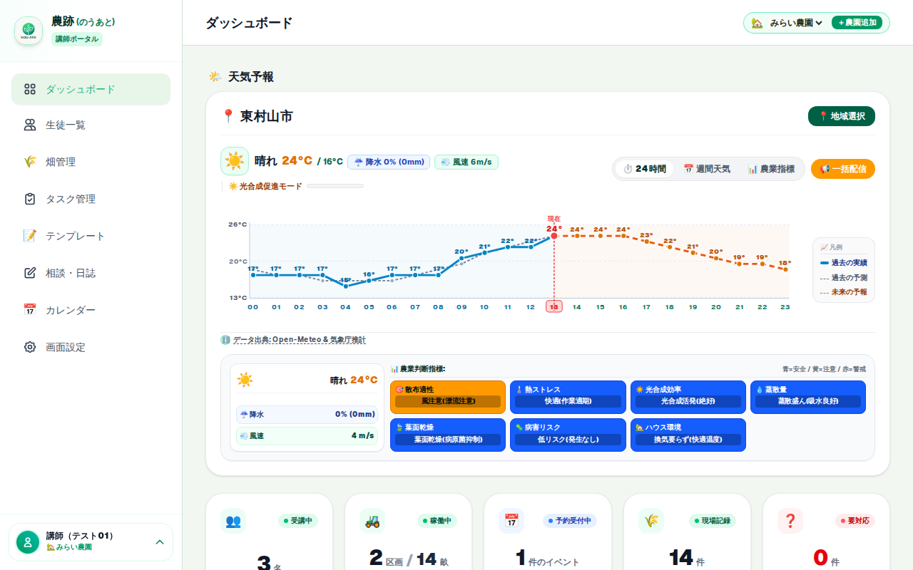
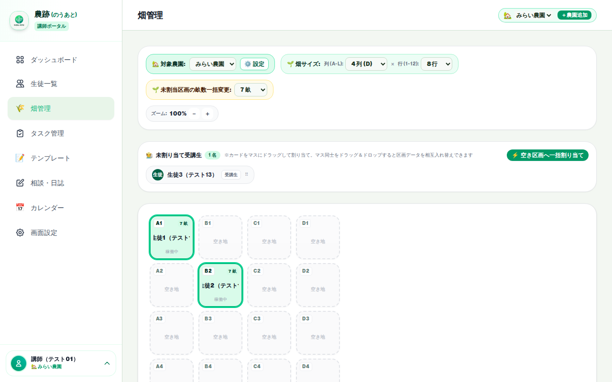
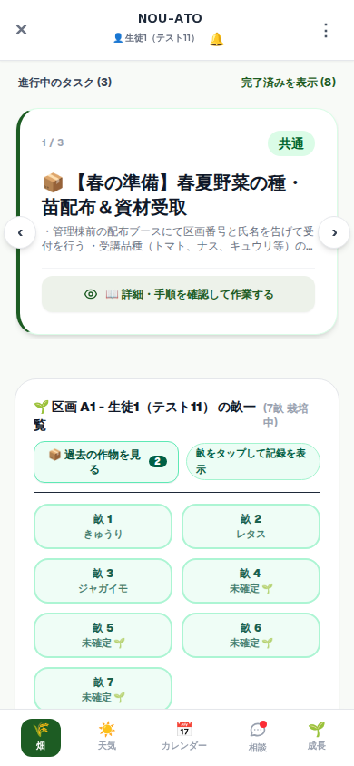
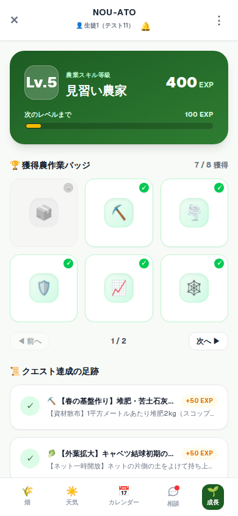

# NOU-ATO (のうあと) - 体験農業経営支援アプリ

「**NOU-ATO（のうあと）**」は、体験農園の運営者（講師）と受講生（生徒）をつなぎ、初心者でも迷わず野菜づくりを楽しみながら学べる体験農業経営支援Webアプリケーションです。

## 📱 アプリケーション画面ギャラリー (UI Screenshots)

### 👨‍🌾 講師向けダッシュボード & 農地マネジメント

|                   📊 ダッシュボード概要                    |           🚜 農地キャンバス (D&D畝配置)           |
| :--------------------------------------------------------: | :-----------------------------------------------: |
|  |  |
|      _受講生進捗、未読日誌、一括アナウンスの一元管理_      | _ドラッグ＆ドロップによる畝・作物レイアウト管理_  |

### 👨‍🎓 受講生向けモバイルポータル

|            📱 マイファーム & タスクスタック             |          🏆 成長スキルボード (3Dバッジ)           |
| :-----------------------------------------------------: | :-----------------------------------------------: |
|  |  |
|  _立体カードスタック & 無限循環による快適なタスク消化_  | _スロット内3Dコイン回転の達成バッジコレクション_  |

> [!TIP]
> 🚀 **本番デプロイURL**: [https://nou-ato.vercel.app](https://nou-ato.vercel.app)  
> 🔑 **ログインURL**: [https://nou-ato.vercel.app/login](https://nou-ato.vercel.app/login)（ログイン画面上に**ワンクリック自動入力ボタン**を完備）

---

## 🚀 デプロイURL & 動作確認用デモアカウント

本アプリケーションは Vercel Edge Network 上に常時デプロイされており、PCおよびスマートフォンのブラウザから即座に動作確認いただけます。

- **本番デプロイURL**: [https://nou-ato.vercel.app](https://nou-ato.vercel.app)
- **ログインURL**: [https://nou-ato.vercel.app/login](https://nou-ato.vercel.app/login)
- **API ドキュメント (Swagger UI)**: [`docs/api-docs.html`](docs/api-docs.html)
- **初心者向け実践解説Webテキスト (HTML)**: [`docs/tutorial/index.html`](docs/tutorial/index.html)（※AI駆動開発の手戻り史と実コード解剖）

### 🔑 動作確認用デモアカウント情報

ログイン画面（[/login](https://nou-ato.vercel.app/login)）の「⚡ ポートフォリオ確認用デモ」枠にあるボタンを押すと、**メールアドレスとパスワードがワンタップで自動入力**されます。手動で入力される場合は以下をご利用ください。

| ロール        | メールアドレス       | パスワード | 初期リダイレクト     | 主な体験可能機能                                                                                                                                                                                                                                                                       |
| :------------ | :------------------- | :--------- | :------------------- | :------------------------------------------------------------------------------------------------------------------------------------------------------------------------------------------------------------------------------------------------------------------------------------- |
| **👨‍🌾 講師**   | `test01@example.com` | `test01`   | `/teacher/dashboard` | ・受講生一覧・ステップ進捗率の把握<br>・農地キャンバス（D&D畝配置・スリム畝カード）<br>・一括アナウンス即時配信<br>・日誌返信 & AIナレッジ化（RAG）承認<br>・農園設定（相談タブON/OFF切り替え）                                                                                        |
| **👨‍🎓 受講生** | `test11@example.com` | `test11`   | `/student`           | ・マイファーム（担当区画 A1：畝ごとの栽培記録・観察タイムライン・収穫アーカイブ）<br>・マイタスク（立体カードスタック & 無限循環ループ）<br>・成長スキルボード（スロット内3Dコイン回転バッジ）<br>・AIしるべぇ相談（チケット制・Yes/No共有トグル）<br>・24時間お天気予報・農園交換日記 |

```text
【クイックコピペ用】
・講師:   test01@example.com / test01
・受講生: test11@example.com / test11
```

---

## 🌾 プロジェクト概要・特徴

- **受講生向け機能 (Student Portal)**:
  - **マイタスク管理 & 進捗可視化 (立体カードスタック)**: 栽培ステップ（土作り、苗植え、芽かき、追肥、収穫など）を段階的にクリア。直感的な**立体カードスタック & 無限循環ループ**UIで快適にタスクをブラウズし、現場での写真添付付き完了報告やメモ記録がスムーズに行えます。
  - **成長スキルボード (3Dバッジコレクション & EXPシステム)**: クリアしたタスクに応じて経験値（EXP）が蓄積され、スロット内で**3Dコイン回転する達成バッジ**を獲得。成長ランク（見習い農家など）の上昇を実感しながら、ゲーム感覚で楽しく野菜づくりの技術習得を継続できます。
  - **AI相棒「しるべぇ」栽培相談 (RAG連携 & プライバシー保護)**: 農園独自の蓄積ノウハウ（ナレッジベース）とGeminiを融合した高精度な栽培アドバイスをいつでも受領可能。1日3回のチケット制（深夜自動回復）や**個人情報（PII）自動マスキング**、農園共有トグルによる安心・安全な対話環境を提供します。
  - **お天気・農園情報 & 交換日記 (24h予報・写真付き交流)**: 畑の位置情報に基づいたリアルタイム天気・降水確率・気温の24時間詳細予報を常時確認可能。さらに日々の観察記録や作業内容を写真付き「交換日記」として投稿し、担当講師から個別のアドバイスやフィードバックを受け取れます。

- **講師向け機能 (Teacher Dashboard)**:
  - **受講生進捗 & 区画マネジメント (一元把握ダッシュボード)**: 全受講生の作業進捗率、区画・畝の利用状況、未読の提出日誌を一覧で可視化。サポートが必要な生徒を即座に特定し、タイムリーな声かけや指導を行えます。
  - **タスク作成・配信 & テンプレート管理 (一括/個別対応)**: 季節や作物に応じた栽培タスクの新規作成、全受講生への一括配信、特定生徒への個別課題割り当てに柔軟対応。再利用可能なタスクテンプレート機能により、毎年の講習計画作成コストを大幅に削減します。
  - **農地キャンバス (D&D畝レイアウト管理)**: ドラッグ＆ドロップ（@dnd-kit）による直感的な操作で、農園全体の区画および畝の並び順や栽培作物をグラフィカルに管理。畝ナンバーと作物名に集約したスリムな畝カード設計で農地の現況を直感的に整理できます。
  - **日誌レビュー・ナレッジ化 (RAG承認) & 一括アナウンス**: 受講生から届いた日誌への返信・個別指導に加え、有益なQ&Aを1クリックで「農園共通ナレッジ」としてAI相談に学習反映。天候不良時の休講や収穫イベントの連絡も全員へ即時アナウンス配信できます。

---

## 🛠️ 技術スタック

| レイヤー                 | 採用技術                                                                                                     |
| :----------------------- | :----------------------------------------------------------------------------------------------------------- |
| **フロントエンド**       | Next.js 16 (App Router), React 19, TypeScript                                                                |
| **スタイリング**         | Tailwind CSS v4                                                                                              |
| **状態管理・D&D**        | Zustand, @dnd-kit (Core, Sortable, Utilities)                                                                |
| **バックエンド / DB**    | Supabase (PostgreSQL, Supabase Auth, SSR, Storage, RLS)                                                      |
| **AI / RAG**             | Google AI Studio (Gemini 2.5 Flash / Flash-Lite: `gemini-flash-lite-latest`), 農園ナレッジ類似度照合エンジン |
| **API アーキテクチャ**   | OpenAPI 3.1, RFC 7807 (Problem Details), Swagger UI                                                          |
| **CI / CD**              | GitHub Actions (Lint, Typecheck, Test, Coverage, Build, Supabase DB Reset & pgTAP)                           |
| **テストフレームワーク** | Vitest (37ファイル・310項目), pgTAP (`supabase test db`: 26項目), @vitest/coverage-v8 (閾値 70% 準拠)        |

---

## 🌐 外部連携API / サービス一覧

本アプリケーションでは、リアルタイム気象データ、位置情報変換、AI対話、SNS認証等の機能提供のため、以下の外部APIおよびクラウドサービスを利用しています。

| サービス名                                    | 用途                                                                        | 呼び出し箇所                                                     | APIキー要否                                                            | 利用規約 / レート制限                                                                                                    |
| :-------------------------------------------- | :-------------------------------------------------------------------------- | :--------------------------------------------------------------- | :--------------------------------------------------------------------- | :----------------------------------------------------------------------------------------------------------------------- |
| **Google AI Studio (Gemini API)**             | AIアシスタント「しるべぇ」のRAG栽培相談・自動回答生成                       | `lib/rag/qaKnowledgeRetriever.ts`<br>`app/api/chat/rag/route.ts` | **要** (`GEMINI_API_KEY`)                                              | 15 RPM / 1,500 RPD (Free Tier)<br>※環境変数 `GEMINI_MODEL` (既定: `gemini-flash-lite-latest`) および自動カスケードに対応 |
| **Open-Meteo Forecast API**                   | ピンポイント農園天気・24時間予報・降水確率・気温・風速・UV予測データの取得  | `components/ui/WeatherWidget.tsx`                                | **不要**                                                               | 10,000 リクエスト/日 (非商用・開発利用無料)                                                                              |
| **Open-Meteo Geocoding API**                  | 地名・市区町村キーワード検索による経度・緯度特定                            | `components/ui/WeatherWidget.tsx`                                | **不要**                                                               | Open-Meteo API Terms 準拠                                                                                                |
| **OpenStreetMap Nominatim API**               | GPS現在位置（緯度・経度）からの逆ジオコーディング（市区町村名・住所の取得） | `components/ui/WeatherWidget.tsx`                                | **不要**                                                               | 最大 1 リクエスト/秒 (User-Agent 必須)                                                                                   |
| **Supabase (Auth / DB / Storage / Realtime)** | ユーザー認証、PostgreSQLデータベース、観察写真ストレージ、リアルタイム同期  | `lib/supabase.ts`<br>API Routes / 各コンポーネント               | **要** (`NEXT_PUBLIC_SUPABASE_URL`<br>`NEXT_PUBLIC_SUPABASE_ANON_KEY`) | Supabase Terms of Service (Free Tier)                                                                                    |
| **LINE Login (Supabase OAuth)**               | LINE アカウントを用いたワンタップソーシャルログイン認証                     | `app/login/page.tsx`                                             | **要** (Supabase DashboardでのLINE Channel設定)                        | LINE Developers Terms of Service                                                                                         |

---

## 🚀 環境構築 & ローカル起動手順

### 1. 前提条件

- Node.js `v20` 以上 (推奨: `v24` 以上)
- npm `v10` 以上
- Supabase アカウント (新規プロジェクト作成用)

### 2. リポジトリのクローンと依存関係インストール

```bash
git clone https://github.com/stakeshita111-cyber/nou-ato.git
cd nou-ato
npm install
```

### 3. Supabase プロジェクトの初期セットアップ (DB & Storage)

ゼロから新規の Supabase 環境を構築する場合は、以下の手順でデータベーススキーマの適用と Storage バケットの設定を行います。

#### A. データベースマイグレーションの実行 (DB Schema)

Supabase CLI を利用する方法、または Supabase Dashboard の SQL Editor を利用する方法のいずれかでマイグレーションを適用します。

##### 方法1: Supabase CLI を使う場合（推奨）

```bash
# 1. Supabase CLI にログイン
npx supabase login

# 2. プロジェクトにリンク (YOUR_PROJECT_REF は Supabase ダッシュボード URL または Settings > General から取得)
npx supabase link --project-ref <YOUR_PROJECT_REF>

# 3. マイグレーションファイルを適用
npx supabase db push
```

##### 方法2: Supabase Dashboard (SQL Editor) を使う場合

1. Supabase Dashboard にログインし、対象プロジェクトを選択します。
2. 左メニューの **SQL Editor** を開きます。
3. `supabase/migrations/` 配下の全44本のマイグレーションファイルをタイムスタンプ順に適用します：
   - `00000000000000_initial_schema.sql` (ベーステーブル・RLS・RPC関数)
   - `20260925000000_database_integrity_and_sync.sql` (外部キー制約、整合性トリガー、マイファーム同期ビュー)
   - `20260926000000_add_show_student_talk_tab_to_farms.sql` (農園テーブルへの相談タブ表示フラグ追加)
   - `20261009010000_chat_rag_security_defense.sql` (AI相談セキュリティ多層防御・入力サニタイズ)
   - `20261009020000_ai_tickets.sql` (AI相談チケット管理テーブル・関数)
   - `20261009030000_batch_student_tasks_cascade.sql` (生徒タスク一括生成・カスケード削除)
   - `20261009040000_prevent_privilege_escalation.sql` (権限昇格防止・RLS強化)
   - `20261009050000_security_advisor_views_and_rls.sql` (VIEW security_invoker設定・監査準拠)
   - `20261010000000_farm_beds_ssot_and_reorder.sql` (畝SSOT管理・並べ替えRPC)
   - `20261010010000_add_description_to_student_tasks.sql` (生徒タスク説明文カラム追加)
   - `20261010020000_purge_all_legacy_policies_and_enforce_strict_rls.sql` (旧RLSポリシー全廃止・厳格ポリシー適用)
   - `20261010030000_link_legacy_student_tasks_to_base_task_id.sql` (既存タスクとbase_task_id紐付け)
   - `20261010040000_crop_records_shared_plot_support.sql` (観察記録の共有区画対応)
   - `20261010050000_add_preset_faqs_to_farms.sql` (農園プリセットFAQ追加)
   - `20261010060000_ai_usage_atomic_and_ticket_hardening.sql` (AIチケット原帳・アトミック更新)
   - `20261010070000_harden_farm_beds_and_broadcast_rls.sql` (畝並べ替え・配信RLS強化)
   - `20261011010000_rag_knowledge_and_journal_triggers.sql` (RAGナレッジ・日誌トリガー)
   - `20261011020000_ai_usage_ledger_and_register_teacher_idempotent.sql` (AI使用台帳・講師登録冪等化)
   - `20261011025000_security_and_data_boundary_hardening.sql` (データ境界厳格化・タスク農園限定・観察記録保護)
   - `20261011030000_announcements_and_farm_metadata.sql` (アナウンス・農園メタデータSSOT)
   - `20261011040000_multi_tenant_and_tampering_defense.sql` (マルチテナントRLS強化・改ざん防止トリガー・CHECK制約)
   - `20261011050000_unify_events_farm_id_to_uuid.sql` (events/reservations farm_id UUID型統一・型安全化)
   - `20261014000000_db_integrity_hardening.sql` (DB整合性強化・旧テーブル安全破棄)
   - `20261014010000_ensure_get_farm_by_invite_code.sql` (招待コードによる農園取得関数保証)
   - `20261014020000_drop_untracked_farm_plots_student_name.sql` (farm_plots 未追跡 student_name カラム削除)
   - `20261014030000_save_ai_journal_rpc.sql` (AI日誌保存アトミックRPC)
   - `20261014040000_fix_add_farm_bed_signature_and_trigger.sql` (add_farm_bed 関数シグネチャ・トリガー修正)
   - `20261014050000_harden_farms_rls_and_revoke_anon.sql` (farms RLS強化・anon権限剥奪)
   - `20261014060000_fix_invite_and_student_tasks_rpc.sql` (招待・生徒タスクRPC修正)
   - `20261014070000_harden_rls_boundaries_and_check_constraints.sql` (RLS境界防衛・CHECK制約強化)
   - `20261014080000_verify_security_and_constraints_rpc.sql` (セキュリティ・制約自動検証RPC)
   - `20261014083000_update_verify_security_rpc.sql` (verify_security RPC改定)
   - `20261014084000_fix_verify_plots_columns.sql` (verify_security 区画カラム検証修正)
   - `20261014085000_fix_farm_plots_name_column.sql` (farm_plots nameカラム検証修正)
   - `20261014090000_fix_crop_records_columns.sql` (crop_records カラム検証修正)
   - `20261014091000_fix_verify_crop_records_ids.sql` (crop_records ID検証修正)
   - `20261014092000_lock_verify_security_and_constraints_rpc.sql` (verify_security_and_constraints RPC確定ロック)
   - `20261015000000_unify_ticket_status_and_storage_update.sql` (チケット残数集計統一・退会時タスク削除・Storage UPDATEポリシー追加)
   - `20261016000000_harden_crop_records_and_student_tasks_and_beds.sql` (作物記録RLS厳格化・タスク完了RPC防衛・畝改ざん防止トリガー)
   - `20261016010000_harden_save_ai_journal_server_only.sql` (save_ai_journal サーバーサイド service_role 専用化)
   - `20261016020000_reconcile_schema_and_foreign_keys.sql` (本番DBとマイグレーション間の列・外部キー完全整合化)
   - `20261016030000_sync_student_published_tasks.sql` (公開済みタスクの受講生先行配備・同期RPC)
   - `20261016040000_harden_student_tasks_rls_and_column_nullability.sql` (student_tasks直接UPDATEのRLS厳格化・NOT NULL制約完全同期)
   - `20261018000000_restore_foreign_keys_and_fix_task_trigger.sql` (users参照の外部キー6本・crop_records.bed_id外部キー復元・タスク同期トリガー修正)

---

#### B. Storage バケット (`crop-photos`) の作成と公開設定

日誌・観察記録投稿時の写真アップロードに必要な `crop-photos` ストレージバケットを作成します。

##### 手順:

1. Supabase Dashboard の左メニューから **Storage** を選択します。
2. **New bucket** ボタンをクリックし、以下の設定でバケットを作成します：
   - **Bucket name**: `crop-photos`
   - **Public bucket**: **ON** (有効化: 投稿された画像URLの公開アクセスのため)
3. バケット作成後、認証済みユーザーが画像をアップロードできるように RLS ポリシー（Policies）を設定します：
   - **SELECT**: `Public` (全員読み取り可能)
   - **INSERT / UPDATE**: `Authenticated users` (ログイン済みユーザーのみアップロード可能)

---

### 4. 環境変数の設定

プロジェクトルートに `.env.local` を作成し、必要なキーを設定します：

```env
# Supabase (Dashboard > Project Settings > API から取得)
NEXT_PUBLIC_SUPABASE_URL=https://your-project.supabase.co
NEXT_PUBLIC_SUPABASE_ANON_KEY=your-anon-key
SUPABASE_SERVICE_ROLE_KEY=your-service-role-key # サーバーサイド特権用 (AI相談履歴 save_ai_journal 等)

# Google AI Studio (Gemini API Key)
GEMINI_API_KEY=your-gemini-api-key
GEMINI_MODEL=gemini-flash-lite-latest # (任意: 自動カスケード gemini-flash-lite-latest / gemini-2.5-flash)

# アプリケーション基本URL
NEXT_PUBLIC_APP_URL=http://localhost:3000

# 機能フラグ
NEXT_PUBLIC_LINE_ENABLED=false
NEXT_PUBLIC_SHOW_DEMO=true # 本番公開時にレビュー用デモボタン枠を非表示にする場合は false に設定
```

### 5. 開発サーバーの起動

```bash
npm run dev
```

ブラウザで [http://localhost:3000](http://localhost:3000) を開きます。

---

## 🧪 テスト・品質検証コマンド

本プロジェクトでは品質とセキュリティを担保するため、CI/CD連動のテストスイート（全37テストファイル / 310項目 ＋ pgTAP 実DBテスト 1ファイル / 26項目全件PASS、カバレッジ90%以上）を配備しています。

```bash
# 1. 自動テストの実行 (全310件・100%通過)
npm run test

# 2. テストカバレッジ検証 (目標値 70% 判定 / 実績 90.1%以上達成)
npm run test:coverage

# 3. TypeScript 型チェック (型エラー0件の検証)
npx tsc --noEmit

# 4. 本番ビルド検証 (Turbopack)
npm run build

# 5. コードスタイル・Lint検証
npm run lint
```

---

## 🗺️ 今後の実装予定機能ロードマップ (Roadmap)

今後のアップデートで以下の機能拡充を予定しています：

1. **💳 Stripe オンライン決済・サブスクリプション連携**:
   - 農園受講料の月額引き落とし、追加AI相談チケット・体験イベント参加費の即時クレジットカード決済。
2. **📲 LINE 公式アカウント Push 通知連携**:
   - 講師からの一括お知らせ配信や、明日の水やりアラート、講師からの日誌返信通知をLINEトーク画面へ即時Push。
3. **📶 PWA (Progressive Web App) & オフライン対応**:
   - 電波の届きにくい畑の現場でも、Service Worker と IndexedDB を用いてオフラインで作業記録や写真を一時保存・電波復旧時に自動同期。
4. **🌡️ IoT 農業環境センサー連携**:
   - 土壌水分量、地温、日照センサーデータをリアルタイム収集し、AIしるべぇが「本日水やりが必要か」を自動判定してアドバイス。

---

## 📂 ディレクトリ構成

```text
nou-ato/
├── .github/              # GitHub Actions CI/CD パイプライン
│   └── workflows/        # ci.yml (品質ゲート & pgTAP実DB検証), deploy.yml (ビルド検証)
├── app/                  # Next.js App Router (ルーティング & API)
│   ├── api/              # API Route Handlers (chat, settings, tickets)
│   ├── auth/             # 認証系画面・コールバック (callback, merge, reset-password等)
│   ├── invite/           # 生徒招待受け取り・参加画面
│   ├── login/            # 認証・ログイン画面
│   ├── student/          # 受講生ポータル画面 (畑/天気/予約/相談/成長)
│   └── teacher/          # 講師ダッシュボード画面 (概要/タスク/生徒/日誌/設定)
├── components/           # UIコンポーネント (teacher, student, ui, board, farm)
├── context/              # React Context プロバイダー (ThemeContext)
├── docs/                 # 仕様書・品質ダッシュボード・OpenAPI・ER図
├── hooks/                # カスタムフック (useKanbanBoard, useDynamicTheme, useFarmManager等)
├── lib/                  # 共通ユーティリティ (RAG, Supabase, TicketManager, logger, apiResponse)
├── scripts/              # データベース監査・ビルド検証スクリプト
├── store/                # Zustand グローバル状態ストア (useThemeStore等)
├── supabase/             # Supabase マイグレーションSQL (46本)・pgTAPテスト (26項目)
├── test/                 # 自動テストスイート (Vitest: 37ファイル・全310項目)
├── types/                # TypeScript型定義 (Database, Supabase)
└── utils/                # サーバー/クライアント用ヘルパー (Supabaseクライアント等)
```

---

## 📑 プロジェクト仕様書・ドキュメント一覧

ブラウザで直接開いて確認・操作できるインタラクティブなHTMLダッシュボード群およびMarkdown仕様書群です。全ドキュメントの上部に**統一ナビゲーションバー**が備わっており、1クリックで相互移動できます。

### 1. 📊 インタラクティブ設計＆検証ダッシュボード (HTML)

| ドキュメント                           | ファイルパス                                                                   | 内容・役割                                                                     |
| :------------------------------------- | :----------------------------------------------------------------------------- | :----------------------------------------------------------------------------- |
| **オリアプレビュー項目DB (全101項目)** | [`docs/review-checklist-dashboard.html`](docs/review-checklist-dashboard.html) | 全101機能・非機能要件の検証ダッシュボード、合否判定、エビデンス集約            |
| **API 仕様書 & Swagger UI**            | [`docs/api-docs.html`](docs/api-docs.html)                                     | OpenAPI 3.1 仕様に基づくブラウザ対話型 API ドキュメント・実行サンドボックス    |
| **ER図 & テーブル定義書**              | [`docs/database-design.html`](docs/database-design.html)                       | Mermaid ER図、全14テーブル+1VIEW+21 RPC関数のカラム型・制約・RLSポリシー設計書 |
| **品質検査計画書 (QA Master Plan)**    | [`docs/test-plan.html`](docs/test-plan.html)                                   | 全テスト項目と完全同期したテスト計画、自動テスト実行・カバレッジ検証           |
| **アーキテクチャ & データフロー**      | [`docs/architecture-map.html`](docs/architecture-map.html)                     | Next.js 16 + Supabase + Gemini RAG + RLS 認可フロー構造図                      |
| **エージェント & スキル活用ガイド**    | [`docs/agent-and-skills-guide.html`](docs/agent-and-skills-guide.html)         | AI開発エージェントチームの役割分担と自律修正プロトコル解説                     |
| **全画面フロー & 仕様マップ**          | [`docs/screen_flow.html`](docs/screen_flow.html)                               | 講師・受講生の全画面遷移、機能、データ連携使い方完全マップ                     |
| **実践解説Webテキスト (Tutorial)**     | [`docs/tutorial/index.html`](docs/tutorial/index.html)                         | AI駆動開発の光と影・泥臭い手戻り史と実コード解剖・教育用完全解説テキスト       |

### 2. 📑 要件定義＆設計仕様書 (Markdown / ブラウザ統合ビューア)

ブラウザ上で美しく読める [**仕様書統合ビューア (docs/markdown-viewer.html)**](docs/markdown-viewer.html) からも全仕様書をワンクリックで閲覧できます。

| ドキュメント                            | ビューアで閲覧                                         | 生ファイル                                                                   | 内容・役割                                                        |
| :-------------------------------------- | :----------------------------------------------------- | :--------------------------------------------------------------------------- | :---------------------------------------------------------------- |
| **要件定義書 (PRD)**                    | [ブラウザで開く](docs/markdown-viewer.html?doc=prd)    | [`PRD.md`](PRD.md)                                                           | プロダクト要求仕様書、ユーザーストーリー、機能要件一覧            |
| **非機能要件定義書**                    | [ブラウザで開く](docs/markdown-viewer.html?doc=nfr)    | [`docs/NON_FUNCTIONAL_REQUIREMENTS.md`](docs/NON_FUNCTIONAL_REQUIREMENTS.md) | パフォーマンスSLO、可用性99.9%、セキュリティRLS監査規準           |
| **セキュリティ & コスト防衛ランブック** | [ブラウザで開く](docs/markdown-viewer.html?doc=sec)    | [`docs/SECURITY_RUNBOOK.md`](docs/SECURITY_RUNBOOK.md)                       | GCP 予算アラート設定、Gemini API Quota 上限、緊急キルスイッチ運用 |
| **ログ設計書**                          | [ブラウザで開く](docs/markdown-viewer.html?doc=log)    | [`docs/LOGGING_DESIGN.md`](docs/LOGGING_DESIGN.md)                           | RFC 7807 統一エラー、機密マスキング、Supabase監査ログ             |
| **データベース設計書 (ERD)**            | [ブラウザで開く](docs/markdown-viewer.html?doc=erd)    | [`docs/ERD.md`](docs/ERD.md)                                                 | スキーマ設計、テーブルリレーション、インデックス設計              |
| **API cURLサンプル集**                  | [ブラウザで開く](docs/markdown-viewer.html?doc=curl)   | [`docs/API_CURL_SAMPLES.md`](docs/API_CURL_SAMPLES.md)                       | 各エンドポイントへのリクエスト例・レスポンス定義                  |
| **画面構造・親子構造図**                | [ブラウザで開く](docs/SITE_STRUCTURE.md)               | [`docs/SITE_STRUCTURE.md`](docs/SITE_STRUCTURE.md)                           | 画面親子ツリー・ルーティング・コンポーネント構成公式設計書        |
| **DB CRUD & API 照合監査書**            | [ブラウザで開く](docs/DATABASE_CRUD_AUDIT.md)          | [`docs/DATABASE_CRUD_AUDIT.md`](docs/DATABASE_CRUD_AUDIT.md)                 | APIルートとSupabase DB全137箇所CRUD操作の完全対比・監査レポート   |
| **エージェント運用規定**                | [ブラウザで開く](docs/markdown-viewer.html?doc=agents) | [`AGENTS.md`](AGENTS.md)                                                     | AI開発エージェント規約、自律型セルフコレクション規定              |
