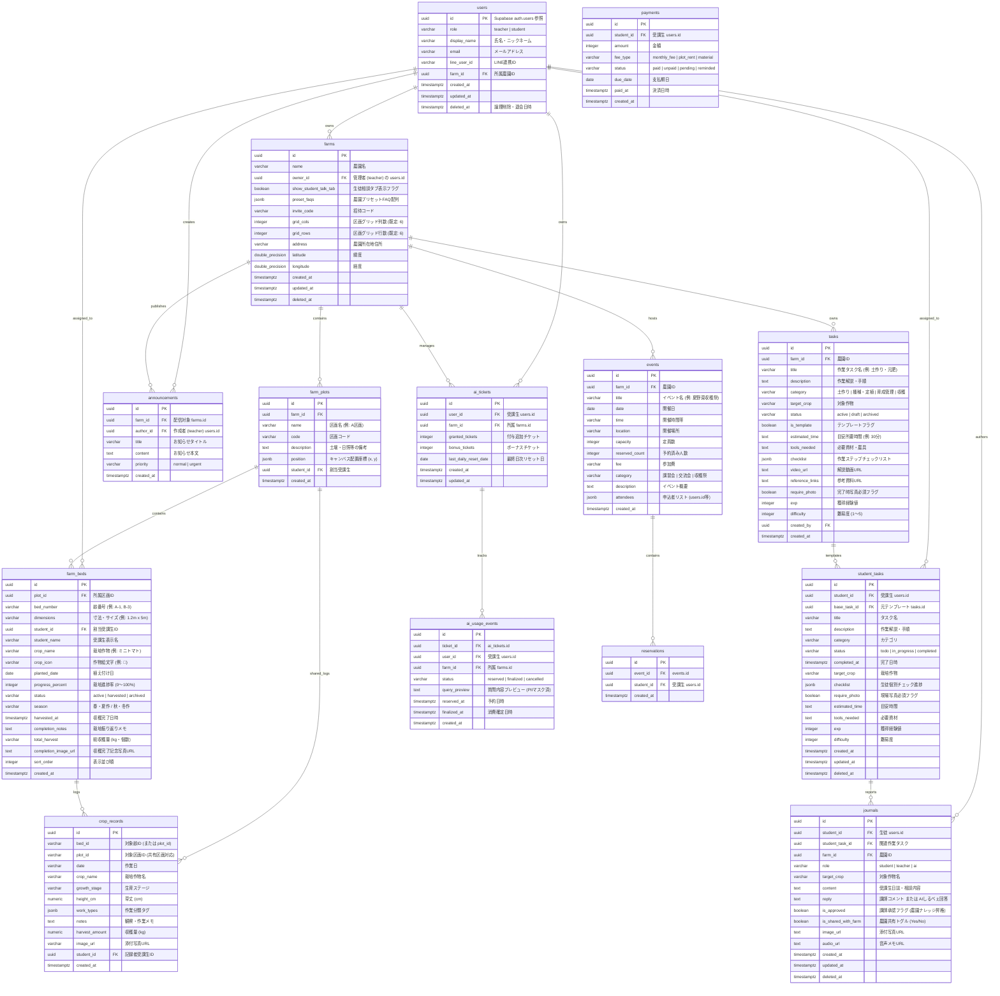

# NOU-ATO (のうあと) データベース ER図 & スキーマ仕様

体験農業経営支援アプリ「NOU-ATO」の PostgreSQL / Supabase リレーショナルデータベース完全設計仕様書です（全14テーブル + 1複合VIEW + 17 RPC関数）。

---

## 1. 概念・物理 ER 図 (Entity Relationship Diagram)

---

## 2. Row Level Security (RLS) ポリシー方針 & View セキュリティ

| テーブル / ビュー                  | 受講生 (student) 権限                                                                                        | 講師 (teacher) 権限                           | サービスロール | セキュリティ設定                 |
| :--------------------------------- | :----------------------------------------------------------------------------------------------------------- | :-------------------------------------------- | :------------- | :------------------------------- |
| **users**                          | 自身のアカウントのみ SELECT / UPDATE                                                                         | 同一農園内の全受講生 SELECT / UPDATE / DELETE | ALL            | RLS Enabled                      |
| **farms**                          | 所属農園のみ SELECT                                                                                          | 自身が所有する農園の ALL                      | ALL            | RLS Enabled                      |
| **farm_plots**                     | 所属農園内の区画を SELECT                                                                                    | 同一農園内の区画の ALL                        | ALL            | RLS Enabled                      |
| **farm_beds**                      | 自身の割当畝を SELECT / UPDATE (トリガーにより区画・畝番・生徒割当・ステータス改ざんを物理遮断)              | 農園内の全畝の ALL                            | ALL            | RLS Enabled                      |
| **crop_records**                   | 自身および所属区画の記録 SELECT / INSERT / UPDATE / DELETE (bed_id 指定時は自身の畝かつ畝区画一致を厳格検証) | 農園内の全記録 SELECT / UPDATE / DELETE       | ALL            | RLS Enabled                      |
| **tasks**                          | 公開テンプレートを SELECT                                                                                    | 農園内のタスクテンプレート ALL                | ALL            | RLS Enabled                      |
| **student_tasks**                  | 自身のタスクのみ SELECT / UPDATE                                                                             | 農園内受講生のタスク ALL                      | ALL            | RLS Enabled                      |
| **journals**                       | 自身の日誌 SELECT / INSERT / UPDATE / 共有済日誌 SELECT                                                      | 全生徒の日誌 SELECT / 返信 UPDATE / 承認      | ALL            | RLS Enabled                      |
| **ai_tickets**                     | 自身のチケット残数 SELECT                                                                                    | 同農園生徒のチケット SELECT / 付与 RPC 経由   | ALL            | RLS Enabled                      |
| **ai_usage_events**                | 自身の利用履歴 SELECT / RPC経由予約                                                                          | 同農園生徒の利用履歴 SELECT                   | ALL            | RLS Enabled                      |
| **announcements**                  | 所属農園のアナウンス SELECT                                                                                  | 自身が作成したアナウンスの ALL                | ALL            | RLS Enabled                      |
| **events**                         | 公開イベントの SELECT / 参加申込 UPDATE                                                                      | イベント作成・更新・削除 ALL                  | ALL            | RLS Enabled                      |
| **reservations**                   | 自身の予約 SELECT / INSERT / DELETE                                                                          | 農園イベントの予約一覧 SELECT / 管理          | ALL            | RLS Enabled                      |
| **payments**                       | 自身の請求 SELECT                                                                                            | 農園内全生徒の請求 SELECT / ステータス UPDATE | ALL            | RLS Enabled                      |
| **farm_beds_with_students (VIEW)** | Invoker 権限で参照 (RLSにより機密情報遮断)                                                                   | Invoker 権限で参照                            | ALL            | `WITH (security_invoker = true)` |

---

## 3. 主要 SSOT 保護 Postgres RPC 関数一覧 (17本)

直接のテーブル更新を物理的に遮断し、整合性と認可を保証するストアドプロシージャ群：

1. **`add_farm_bed`**: 指定区画への畝の安全な追加（ソート順・番号の自動採番）。
2. **`delete_farm_bed`**: 権限検証を伴う畝の安全な削除・後続畝の自動番号振り直し。
3. **`reorder_beds` / `reorder_farm_beds`**: ドラッグ＆ドロップによる畝順序の原子的並べ替え。
4. **`grant_ai_tickets`**: 講師による同農園受講生への追加相談チケット付与。
5. **`reserve_ai_usage`**: 相談開始時のチケット消費枠事前確保（2フェーズ原帳）。
6. **`finalize_ai_usage`**: 回答生成完了時のチケット消費本確定。
7. **`check_and_increment_ai_usage`**: チケット残数のアトミック判定・即時消費。
8. **`get_ai_ticket_status`**: 今日の基本チケット・付与チケット残数の一括照会。
9. **`publish_task_to_all_students`**: 全受講生への教材タスク一括同時配信。
10. **`batch_create_student_tasks`**: トランザクション内での複数タスク一括生成。
11. **`register_teacher`**: 講師新規開設時のアカウント・農園プロファイル原子的作成（冪等化対応）。
12. **`join_farm`**: 招待コードによる受講生の農園安全参加。
13. **`withdraw_student`**: 受講生の農園脱退処理・紐付け解除。
14. **`get_farm_by_invite_code`**: 招待コード検証と農園情報取得。
15. **`list_farm_member_names`**: PIIマスキング用受講生表示名リストのセキュア取得。
16. **`search_knowledge_candidates`**: RAG用の承認済み日誌・Q&A類似ナレッジ抽出。
17. **`complete_student_task`**: 受講生の配信タスク完了・ステータス更新・経験値加算の安全実行（配信タスクかつ公開中のみ実行許可）。

---

## 4. Supabase Security Advisor 監査準拠基準

1. **全ビューにおける Definer 権限バイパス遮断**: すべての Postgres ビュー (`farm_beds_with_students` 等) に `WITH (security_invoker = true)` を明示的に設定し、呼び出し元の RLS ポリシーを評価。
2. **全テーブルへの RLS 適用**: public スキーマのすべてのリレーショナルテーブルで `ENABLE ROW LEVEL SECURITY` を有効化。
3. **SECURITY DEFINER 関数の search_path 保護**: 全ストアドプロシージャに `SET search_path = public` を適用し、search_path 乗っ取り攻撃を完全に防止。
